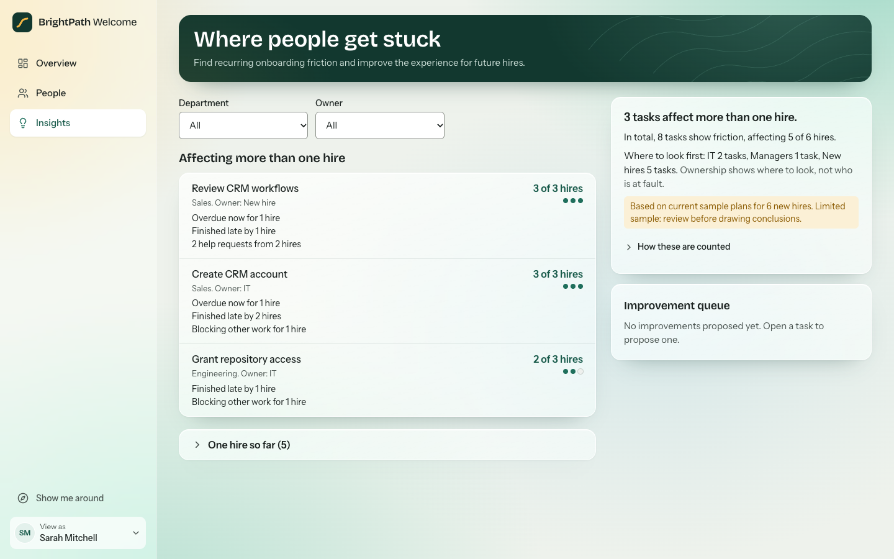
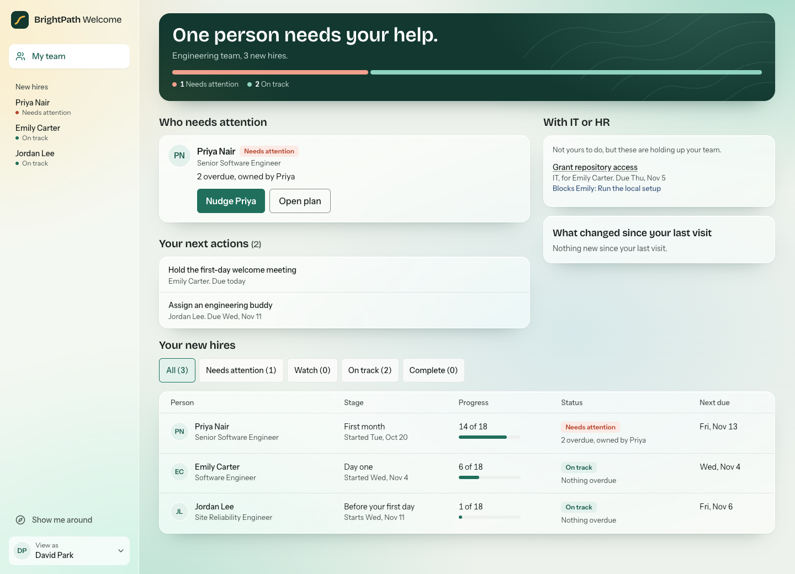
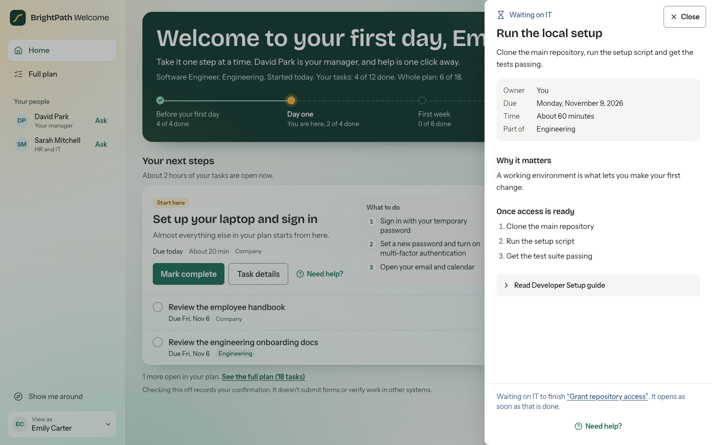
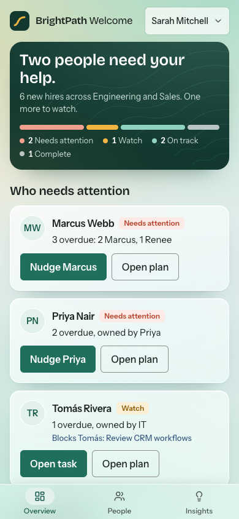
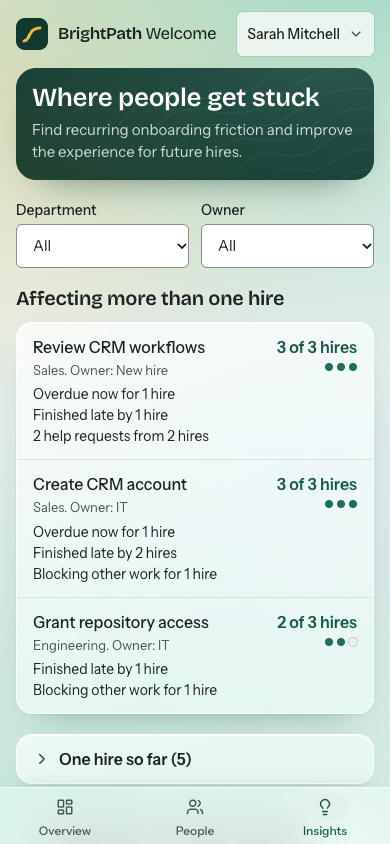

# BrightPath Welcome

BrightPath Welcome is a working onboarding prototype for BrightPath Technologies, a fictional company of about 150 employees. I built it for the MangoApps Associate Product Manager, AI Builder take-home (Scenario 1).

**[Watch the demo video](https://youtu.be/XOYL2g4XAaM)** (under 5 minutes).

Each person gets a clear answer to their own question:

- **New hires:** what should I do next, and who can help me?
- **Managers:** who needs my attention, and what should I do?
- **HR:** how is onboarding going, and where does our process need improvement?


## Run it

You need Node 20.19, or 22.12 or newer, which is what Vite requires. I tested with Node 24.10 only.

```bash
npm install
npm run dev
```

Open the URL that Vite prints. It is usually http://localhost:5173.

The prototype has no login. Because this is a demo, a tour of each person's view opens after every page load. To stop that, clear the checkbox on the tour card. To replay it, click **Show me around**. Use the **View as** menu to switch people and to reset the demo data. On a phone, both are in that menu.

To see the views update together, open the app in two windows and choose a different person in each.

## How the disagreement is resolved

David wants department-specific requirements. Emily does not want to see 40 tasks on day one. These requests do not conflict, because David's request is about which tasks exist and Emily's is about how many appear at once.

- **Plans follow David.** Each plan has 11 company tasks and 7 department tasks, and each task is labelled.
- **The home screen follows Emily.** It shows at most three tasks and gives the first one the most weight. The full plan is one click away.

## What works

**New hire**
- A home screen with a journey across four stages. Position shows time, and only the text shows completed tasks.
- Up to three next steps. The first shows why it matters and what to do, with an estimate of how long the open tasks should take.
- Progress that shows the person's own tasks apart from the whole plan.
- Blocked tasks that name the owner and the exact prerequisite, say if it is late, and never count against the new hire.
- "Have a question?", which answers from the person's own plan. It uses simple matching, not AI, and says so.
- "Ask for help", which sends a prepared request to the person who can act, and shows its status.
- A full plan grouped by phase, with complete and undo on task details.
- A useful finished state, with the completed plan and sample resources.

**Manager**
- Cards that say who needs attention, why, and what to do next.
- Their own tasks, kept apart from work with IT or HR that is holding up the team.
- "What changed since your last visit", from a real activity log.
- A roster of their own team only.

**HR, in three areas**
- **Overview:** who needs attention, help requests, and HR and IT tasks kept apart.
- **People:** every new hire, with status and department filters, sorting, and a form to start a new plan.
- **Insights:** "Where people get stuck", described below.

**Across the app**
- Changes persist through a refresh and sync live between tabs.
- Every screen has its own link, and bad links show a clear message.
- A tour for each person that moves between pages, with 9 to 13 steps. It works by keyboard and on phones, and it changes no data.
- A sidebar that shows new hires who can help them, and shows leaders their new hires by status.
- Links to the task being discussed, from nudges, help requests, and reasons for a flag.

## Where people get stuck

Fixing one person's problem does not fix the process, so Sarah can see which tasks trip up more than one hire.



- **It uses real records.** Figures come from current plans, completion dates, and help requests. Sample data is labelled as sample data, and nothing is a trend.
- **It counts carefully.** Each hire counts once per task. Requests are counted apart from the people asking. Overdue now, finished late, and blocking are kept apart.
- **It separates patterns from one-offs.** One person's delay stays out of the way until asked for.
- **It says what it does not know.** Each task lists what the records cannot show, such as why something ran late.
- **Suggestions come from simple rules,** and are labelled "Suggestion, not a proven cause".
- **Sarah can propose an improvement.** A proposal goes in a queue with a status. It never changes a live plan or a legal requirement.

## Screenshots

**HR overview:** what needs attention now.


**Manager dashboard:** whose work is whose, and what changed.



**A blocked task** does not read as ready to start.



**Phone layouts** have their own structure, with a tab bar and a shorter page.

<p>
  
  
  
</p>

## What is real and what is simulated

| Real in this prototype | Simulated or absent |
|---|---|
| Status, progress, insights, and permission rules | Login. The View as menu stands in for it, so nothing here is secure |
| Saved changes, in this browser's localStorage | A server. Nothing is shared between browsers |
| Nudges and help requests, which appear in the app | Email and Slack. The screen says that no email is sent |
| Answers to questions, from the person's real plan | An AI model. Using one would need a secure backend, so the panel says "not AI" |
| An activity log of what happens from now on | History before the log began. It is not invented |
| Six short sample documents you can read in the task drawer | Real company documents. Each excerpt is labelled as a sample |
| Marking a task complete, as the person's own confirmation | Documents, forms, and e-signature. The screen says that checking off does not submit or verify anything |

## Key assumptions

- Emily is an engineer on David's team. The scenario does not give Emily a department.
- A task becomes overdue on the next business day after its due date.
- A task waiting on someone else is never overdue. The late task counts once, against its own owner.
- Upcoming tasks cannot be completed early.
- "Needs attention" means two or more overdue tasks, or one task at least three business days late.
- Sarah stands in for IT, because the prototype has no IT role.

## What I would ask Sarah next

- Which tasks must every department complete?
- Which dates are legally fixed?
- What would make you step in for a new hire?
- Who chases IT today?
- Which questions do new hires ask you most often?

## What I left out, and why

- **Template editor and rule engine.** Sarah said "eventually", and plans are already data that a later builder can use.
- **A real AI model.** It would need a secure backend, and a frontend API key is not acceptable. A model should answer only from sources it can cite, send sensitive questions to HR, and never mark a task done or judge an employee.
- **Real documents, e-signature, and I-9 handling.** Faking compliance is risky.
- **Email and calendar connections.** They need a backend, and I would not invent addresses.
- **Decorative charts and gamification.** Neither answers a question in the brief.

## Technical choices

- **React, TypeScript, and Vite** run with no server, so anyone can start the app with two commands.
- **Tailwind CSS v4** holds the design tokens. **Radix** provides the accessible drawer and menu.
- **`src/domain/`** holds the product rules as pure functions that take `today` as an argument, so every screen shares one calculation.
- **`src/store/`** validates saved data on load, migrates older versions, and re-reads before each change.
- **The URL holds the person and screen,** so two windows can show different people.

In a real product, the rules in `src/domain/` and their tests carry over. Sign-in, permissions, data, and reminders would move to a server, with every read and write checked there.

## Testing

```bash
npm test             # 214 unit tests
npm run test:e2e     # 177 browser tests, using your installed Chrome
npm run build        # type-check and production build
```

The browser tests cover journeys across roles, refresh, tab sync, corrupted and blocked storage, older saved data, bad links, form validation, weekend dates, keyboard use, reduced motion, and phone layouts. They also run an axe accessibility scan on key screens at desktop and phone widths.


## How I checked the AI's work

I built this with Claude Code, used separate AI reviews, and tried each role myself. Passing tests were not enough:

- All tests passed on a pinned back button that felt wrong when I used it, so I had it moved.
- All tests passed while the tour's spotlight pointed at empty space. Reviewing screenshots caught it, and position tests now cover it.
- An independent review found a question sent to HR showing up in a manager's activity feed. Events now carry an audience, and a test covers it.

## Time

The assignment asks to stop at 3 hours. By my computer's clock, the first complete version took about 3 hours 15 minutes, including time spent reviewing and waiting. That version is commit `ade4fe7`. I then chose to keep improving the product, so the redesign and Insights came after the limit.

Across all of it, I was hands-on for roughly two and a half hours. Elapsed time was longer, because the AI kept working while I stepped away. The commit history shows the timing.

## Known limitations

- I tested only in Chrome, not in Safari or Firefox. No one has tested the app with a screen reader, on a real phone, or with real users.
- Automated accessibility scans catch only some problems.
- Permissions run in the browser, as a demo only.
- Question answers use simple pattern matching, so unusual wording may not be understood.
- Sample dates stay fixed until you reset them, so overdue counts grow if you return days later.
- If you create the sample data on a weekend, Emily's first day is the previous Friday, so Emily appears in the first week.
- A task becoming overdue is not recorded as activity, because nothing runs while the app is closed.
