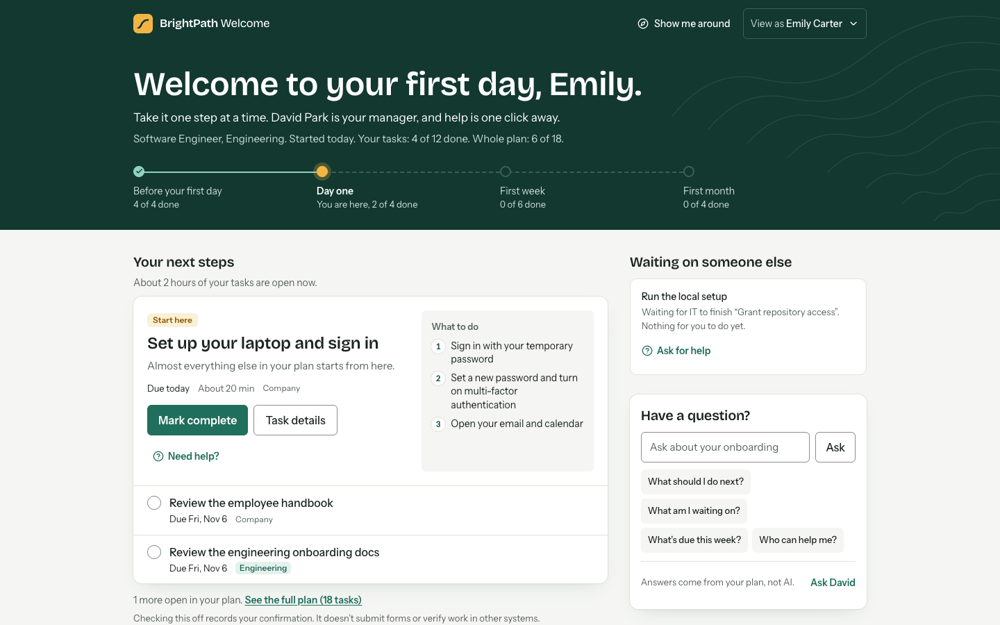
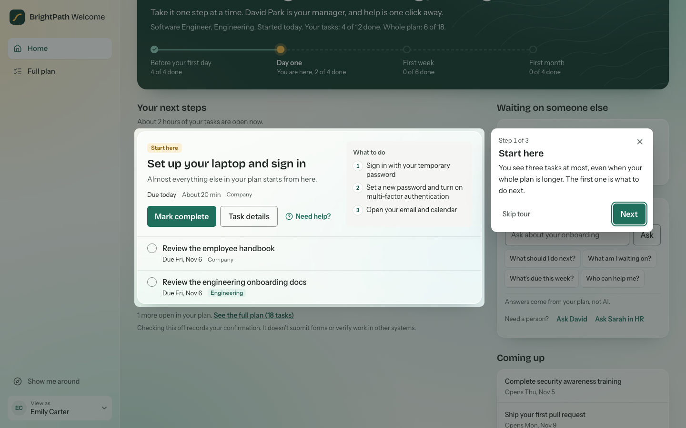
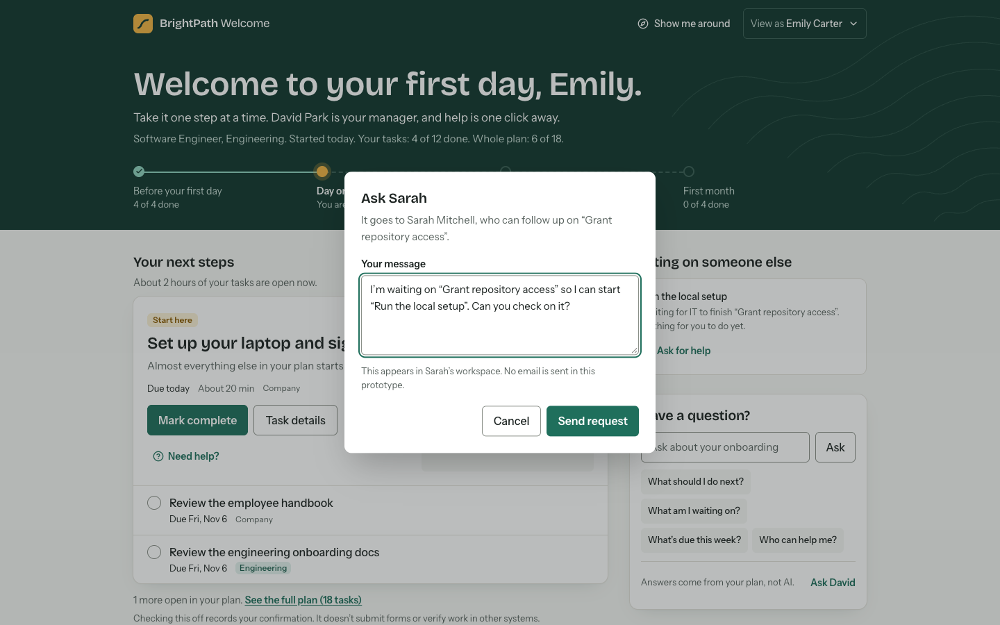
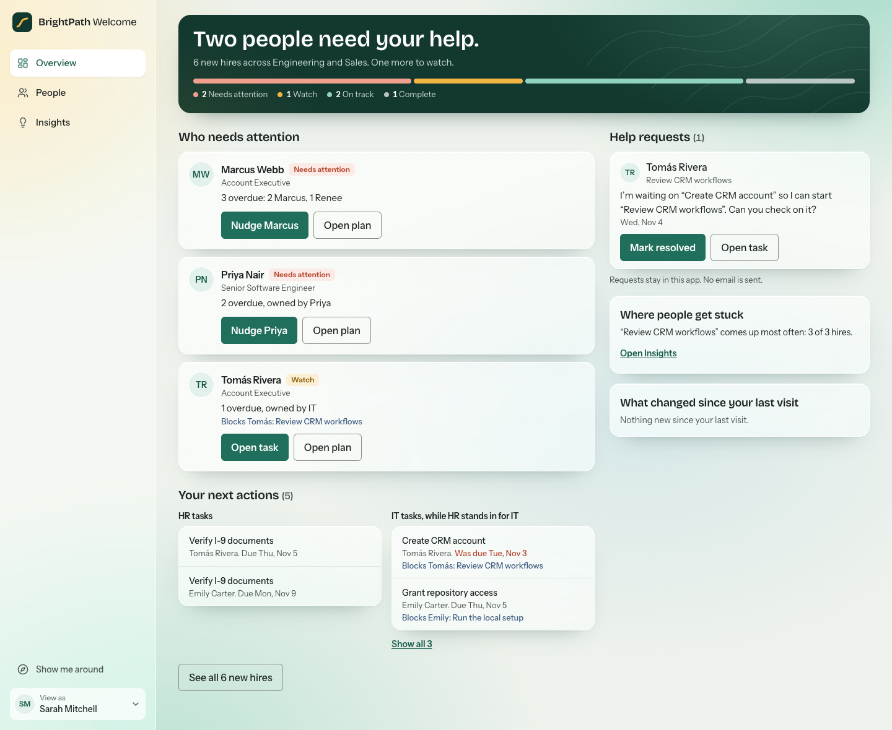
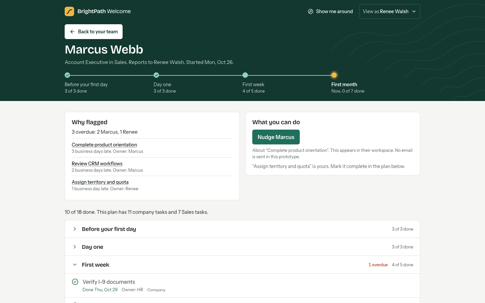
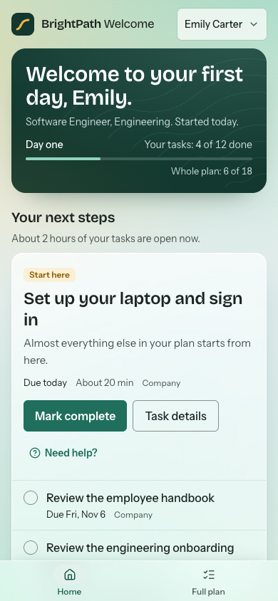
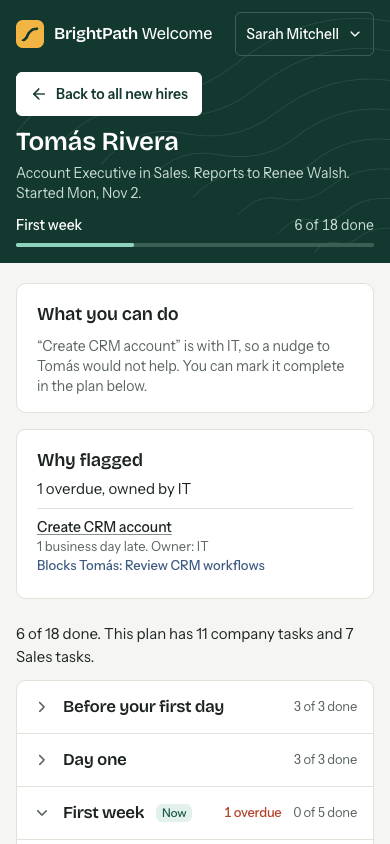

# BrightPath Welcome

BrightPath Welcome is a working onboarding prototype for BrightPath Technologies, a fictional company of about 150 employees. I built it for the MangoApps Associate Product Manager, AI Builder take-home (Scenario 1).

New hires see what to focus on next. Managers and HR see who is on track and who needs help.



## Who it serves

- **New hires** want to know what to do first, without facing a long checklist on day one.
- **Hiring managers** need to see how their own new hires are progressing.
- **HR** needs to see everyone and start plans.

## Run it

You need Node 20.19, or 22.12 or newer, which is what Vite requires. I tested with Node 24.10 only.

```bash
npm install
npm run dev
```

Open the URL that Vite prints. It is usually http://localhost:5173.

The prototype has no login. A short tour opens by itself the first time each person is viewed in a browser. To replay it, click **Show me around** at the top right. On a phone, it is in the **View as** menu, which also switches people and resets the demo data.

To see the employee and manager views update together, open the app in two windows and choose a different person in each.

## How the disagreement is resolved

David wants department-specific requirements. Emily does not want to see 40 tasks on day one. These requests do not conflict, because David's request is about which tasks exist and Emily's is about how many appear at once.

- **Plans follow David.** Each plan has 11 company tasks and 7 department tasks, and each task is labelled.
- **The home screen follows Emily.** It shows at most three tasks and gives the first one the most weight. The full plan is one click away.

## What works

**New hire**
- A home screen with stage and up to three next steps. Progress shows the person's own tasks apart from the whole plan.
- Separate lists for tasks waiting on someone else and for what is coming up.
- A journey across four stages, where position shows time and only the text shows completed tasks.
- A first task that shows why it matters and what to do, with an estimate of how long the open tasks should take. Tasks with no estimate are counted, not guessed.
- "Have a question?", which answers from the person's own plan. It uses simple matching, not AI, and says so. It admits when it cannot answer.
- "Ask for help", which sends a prepared in-app request to the person who can act, and shows its status.
- A full plan grouped by phase.
- Task details with complete and undo.
- Completed, outstanding, upcoming, waiting, and overdue states. Each one has its own colour, icon, and text.

**Manager and HR**
- "Who needs attention" cards that say who, why, and what to do next.
- Help requests sent by new hires, which the recipient can resolve.
- A short "Your next actions" list of the tasks that person can complete. Each row links to the real task and names any work it blocks. Sarah sees HR and IT tasks apart.
- A roster sorted by need, with the reason for each flag written out, including who owns the overdue work.
- A filter, and a detail page with the same plan the new hire sees.
- A nudge that appears on the new hire's home screen.
- Managers see only their own team. HR sees everyone.

**HR only**
- A form that starts a new plan. The preview changes with the department, and the form rejects bad input.

**Across the app**
- A guided tour for each person's view, which opens on their first visit and can be replayed. It works by keyboard and on phones, and it changes no data.
- Links to the task being discussed, from nudges, help requests, reasons for a flag, and blocked tasks.
- Changes persist through a refresh and sync live between tabs.
- Every screen has its own link, and bad links show a clear message.
- Detail screens have a clear Back button on the left above the title, and long pages have another at the end. New pages open at the top, and going back returns to your place in the list.
- Sample dates are relative to the day the data was created, so the demo does not go stale.

## Screenshots

**The first visit opens a short tour.** Each person gets their own.



**A blocked task names who owns the blocker, and asking for help takes one click.**



**The team page says who needs attention, why, and what to do next.**



**Detail screens have a clear way back on the left, and the reason for a flag links to the task.**



**Phone layouts are designed separately, not squeezed from desktop.**

<p>
  
  
</p>

## What is real and what is simulated

| Real in this prototype | Simulated or absent |
|---|---|
| Status, progress, and permission rules | Login. The View as menu stands in for it |
| Saved changes, in this browser's localStorage | A server. Nothing is shared between browsers |
| Nudges and help requests, which appear in the app | Email and Slack. The screen says that no email is sent |
| Answers to questions, from the person's real plan | An AI model. Using one would need a secure backend, so the panel says "not AI" |
| Plans created from company and department task lists | A rule engine or AI plan generation |
| Six short sample documents you can read in the task drawer | Real company documents. Each excerpt is labelled as a sample |
| Marking a task complete, as the person's own confirmation | Documents, forms, and e-signature. The screen says that checking off does not submit or verify anything |

Sarah also stands in for IT, because the prototype has no IT role.

## Key assumptions

The full list, with what I would ask Sarah about each, is in [docs/decisions.md](docs/decisions.md).

- Emily is an engineer on David's team. The scenario does not give Emily a department.
- A task becomes overdue on the next business day after its due date.
- A task that is waiting on someone else is never overdue. The late task counts once, against its own owner.
- Upcoming tasks cannot be completed early.
- "Needs attention" means two or more overdue tasks, or one task at least three business days late.
- Plans cover about the first 30 days, and task wording assumes a US employer.

## What I left out, and why

- **Template editor and rule engine.** Sarah said "eventually", and plans are already data that a later builder can use.
- **AI plan generation and a real AI assistant.** The MangoApps public site already advertises AI-drafted plans, and an assistant would need a secure backend. A frontend API key is not acceptable, so questions use simple rules instead.
- **Real documents, e-signature, and I-9 handling.** Faking compliance is risky.
- **Email and calendar connections.** They need a backend.
- **Charts and gamification.** Neither answers a question in the brief.
- **MangoApps colours.** BrightPath is the customer, so the prototype keeps its own identity. Orange and yellow would also sit too close to the Watch and overdue colours.

The full exclusions table is in [docs/plan.md](docs/plan.md).

## Technical choices

- **React, TypeScript, and Vite** run with no server, so anyone can start the app with two commands.
- **Tailwind CSS v4** holds the design tokens. **Radix** provides the accessible drawer and menu.
- **`src/domain/`** holds the product rules as pure functions that take `today` as an argument. Tests can fix the date, and every screen uses the same progress calculation.
- **`src/store/`** validates saved data on load and re-reads it before each change, so a stale tab cannot overwrite newer work.
- **The URL holds the person and screen.** Two windows can show different people, and links survive a refresh.

## Testing

```bash
npm test             # 174 unit tests
npm run test:e2e     # 138 browser tests, using your installed Chrome
npm run build        # type-check and production build
```

The browser tests cover the full journey across roles, refresh, tab sync, corrupted and blocked storage, bad links, form validation, weekend dates, keyboard use, and reduced motion. They also run an axe accessibility scan on 10 screens at desktop and phone widths, and check for sideways scrolling.

I also checked the AI's work by hand. [docs/ai-review-log.md](docs/ai-review-log.md) records what those checks found, including a test that could not fail and research claims that were wrong. Codex reviewed the code and product twice, and a separate AI critic reviewed the screens.

## Known limitations

- I tested only in Chrome, not in Safari or Firefox. Browsers without view transitions skip the cross-fade.
- Automated accessibility scans catch only some problems, and no one has tested the app with a screen reader.
- Two tabs that write within the same instant could lose one change. A person clicking cannot realistically cause this, and a real product would use a server.
- Sample dates stay fixed until you reset them, so overdue counts grow if you return days later.
- If you create the sample data on a weekend, Emily's first day is the previous Friday, so Emily appears in the first week.

## More documents

- [Demo script](docs/demo-script.md)
- [Product plan and rules](docs/plan.md)
- [What comes next, including AI guardrails](docs/next-steps.md)
- [Research notes](docs/research/)
